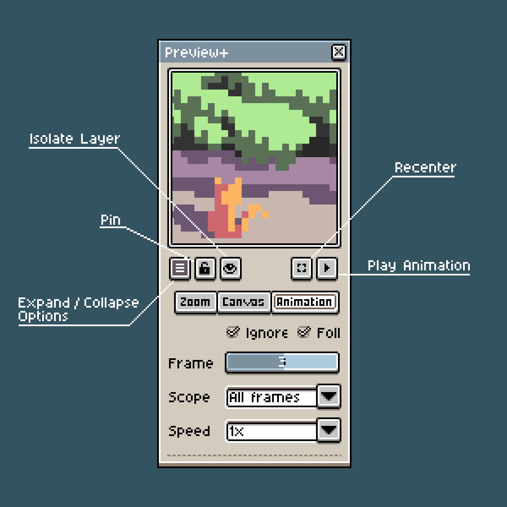
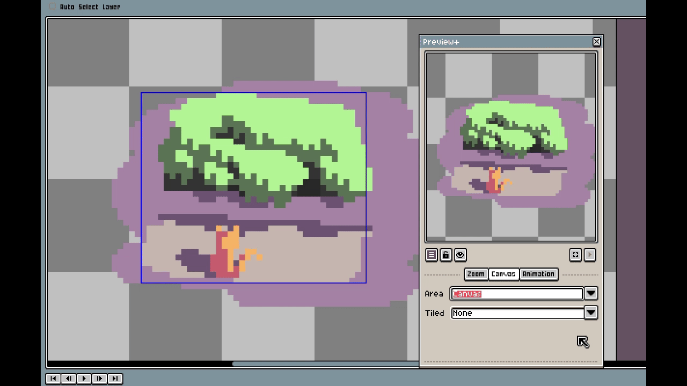
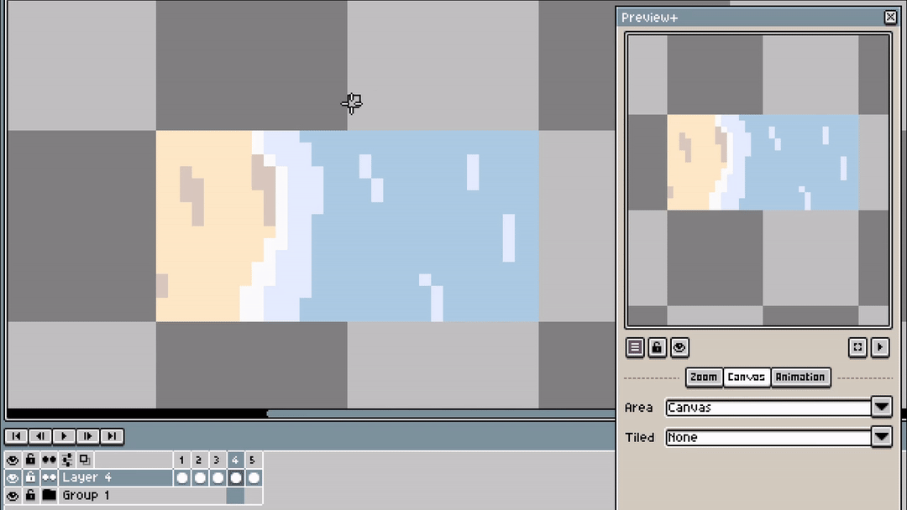
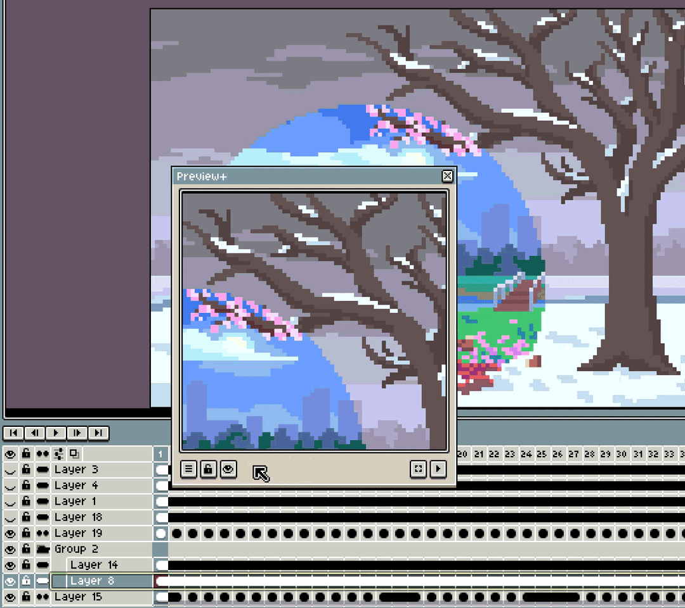
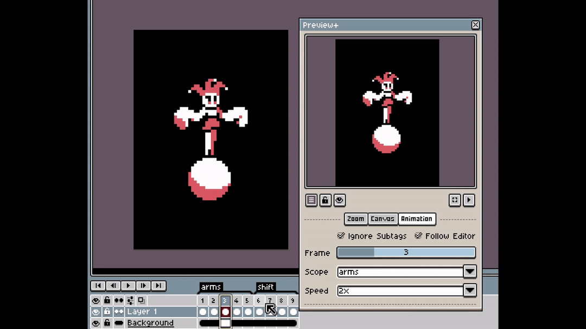

  

<h1 align="center">Preview Plus for Aseprite</h1>

An <a href="https://aseprite.org/">Aseprite</a> plugin that adds a preview window with extra functionality

I made this to experiment with plugins and make previews more useful for me. I hope other people can find use in it.

## Features
* **Display Area** - Choose what part of the canvas (selection or slice) to display in the preview. Useful framing and composition in a larger canvas

</img>

* **Tiling**- Tile in just the preview window without having to make a separate sprite

* **Isolate layer** - View just the selected layer OR group of layers

* **Pin** - Pin to see the preview window for a sprite no matter what tab you are on
* **Animation Playback** - By default, the window behaves just like the Aseprite version
  * **Frame Slider** - Show a different frame that what is selected in editor
  * **Scope tag** - Set a scope tag for just the portion of animation you want to play
  * **Ignore sub tags** - Choose to follow sub tags just like the main editor

## Usage
With a sprite open in Aseprite, go to `View > Preview Plus > Preview Plus` to open a new preview window.

## Installation
1. Download preview-plus.aseprite-extension from [itch.io](https://zanada.itch.io/preview-plus-for-aseprite) or from the [latest release](https://github.com/zanada/preview-plus/releases/latest)
2. Double-click the file to install. OR
1. In Aseprite, Go to `Edit > Preferences > Extensions` and click the `Add Extension` button.
2. Navigate to and select the downloaded file.
